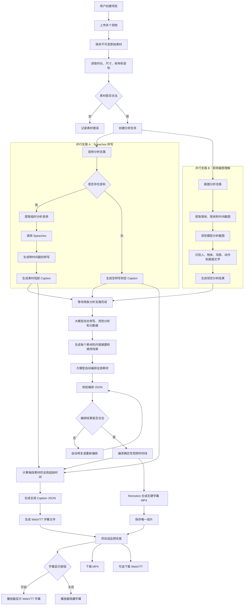

# 自动视频编排与合成程序——AI 实施计划

## 一、项目目标

实现一个自动视频处理程序：

1. 用户创建项目并上传多个带音频的视频。
2. 系统保存原始素材，不裁剪、不调色、不降噪、不变速、不覆盖原文件。
3. 系统并行执行：
   - 使用 Speaches 转写视频语音。
   - 提取视频截图并理解画面内容。
4. 大模型读取转写文字、截图分析结果和视频元数据，理解每个视频。
5. 大模型自动决定全部素材的播放顺序。
6. 程序将排序结果编译为确定性的 Remotion 时间线。
7. Remotion 按顺序完整拼接素材，生成一份无硬字幕 MP4。
8. 系统生成 Caption JSON 和 WebVTT 外挂字幕。
9. 项目内提供成品预览窗，组合 MP4 和 WebVTT。
10. 用户通过预览窗的字幕按钮控制字幕显示或隐藏。
11. 用户不能拖动或手动修改素材顺序。

## 二、固定产品决策

编码 AI 不得擅自改变以下决定：

- 原始视频是不可变素材。
- 素材完整播放，不做内部裁剪。
- 素材不转码、不调色、不降噪、不变速。
- 音频提取和视频截图属于临时分析产物，不属于修改原始素材。
- 视频最终由 Remotion 重新编码为成片 MP4。
- Speaches 只负责语音转写。
- 大模型不读取原始音频，只读取 Speaches 转写的文字。
- 视觉模型读取视频截图，不读取完整视频。
- Speaches 转写和视频截图分析必须并行执行。
- 大模型负责理解内容和排列素材，不生成 Remotion 代码。
- 时间线帧数、起始位置和总时长必须由程序计算。
- 字幕始终生成，不受字幕显示开关影响。
- 字幕不烧录进默认成片。
- 默认只保存一份无硬字幕 MP4。
- 字幕通过 WebVTT 在项目成品预览窗中显示。
- 字幕开关只是播放器显示设置，不触发重新分析或重新渲染。
- 不开发拖动排序、手工排序或多轨时间线编辑器。

## 三、最终工作流程



## 四、系统模块

### 1. 项目管理模块

负责：

- 创建项目。
- 查询项目详情。
- 展示整体处理状态。
- 展示各步骤进度。
- 展示分析结果和编排结果。
- 展示成品预览窗。
- 下载成片和字幕。
- 失败任务重试。

项目状态：

```ts
type ProjectStatus =
  | "draft"
  | "uploading"
  | "probing"
  | "analyzing"
  | "planning"
  | "timeline_ready"
  | "rendering"
  | "completed"
  | "failed";
```

处理步骤：

```ts
type StepName =
  | "probe"
  | "extract_audio"
  | "transcription"
  | "screenshots"
  | "visual_analysis"
  | "asset_understanding"
  | "planning"
  | "timeline"
  | "captions"
  | "render";

interface ProcessingStep {
  name: StepName;
  status: "pending" | "running" | "completed" | "failed";
  progress: number;
  attempts: number;
  startedAt?: string;
  completedAt?: string;
  errorCode?: string;
  errorMessage?: string;
}
```

### 2. 素材上传与存储模块

负责：

- 多文件上传。
- 文件扩展名和 MIME 类型校验。
- 文件大小限制。
- 文件哈希计算。
- 重复素材识别。
- 原始文件持久化。
- 上传进度。
- 文件访问权限。

```ts
interface VideoAsset {
  id: string;
  projectId: string;
  originalName: string;
  originalUrl: string;
  mimeType: string;
  fileSize: number;
  checksum: string;
  status: "uploaded" | "processing" | "ready" | "failed";
}
```

原始素材上传后禁止覆盖写入、裁剪、转码、调色、降噪、修改分辨率、修改音量和修改播放速度。

### 3. 媒体信息检测模块

使用 FFprobe 或项目已有媒体解析工具读取：

```ts
interface AssetMetadata {
  assetId: string;
  durationMs: number;
  width: number;
  height: number;
  fps: number;
  videoCodec: string;
  hasAudio: boolean;
  audioCodec?: string;
  sampleRate?: number;
  channels?: number;
  orientation: "landscape" | "portrait" | "square";
}
```

校验内容：

- 视频是否能够解码。
- 视频时长是否大于零。
- 宽度、高度和帧率是否有效。
- 是否包含视频轨和音轨。
- 当前渲染环境是否支持素材编码。

如果素材编码无法被 Remotion 渲染，不要自动转码原素材。将素材标记为 `unsupported_asset` 并给出明确错误。

### 4. 音频提取模块

从视频中提取临时分析音频，推荐为 WAV、16 kHz、单声道。

要求：

- 输出到临时分析目录。
- 文件名包含 `assetId`。
- 不覆盖原视频。
- 转写完成后允许自动删除。
- 无音轨素材跳过该步骤。
- 无音轨素材仍可参与视觉分析和视频编排。

### 5. Speaches 转写模块

Speaches 作为独立服务运行，底层使用 faster-whisper，并通过兼容 OpenAI 的接口接入。

```env
SPEACHES_BASE_URL=http://speaches:8000/v1
SPEACHES_API_KEY=replace-with-private-key
SPEACHES_MODEL=Systran/faster-whisper-large-v3
SPEACHES_TIMEOUT_MS=600000
SPEACHES_MAX_RETRIES=2
```

调用接口：

```text
POST /v1/audio/transcriptions
```

请求参数：

```text
file=<临时分析音频>
model=<SPEACHES_MODEL>
response_format=verbose_json
timestamp_granularities[]=segment
timestamp_granularities[]=word
temperature=0
language=zh
```

Speaches 提供兼容 OpenAI 的转写接口，可以使用 OpenAI SDK 并修改 `baseURL` 接入。参考：[Speaches Speech-to-Text 文档](https://github.com/speaches-ai/speaches/blob/master/docs/usage/speech-to-text.md)。

先定义 Provider 接口：

```ts
interface TranscriptionProvider {
  healthCheck(): Promise<boolean>;

  transcribe(input: {
    assetId: string;
    filePath: string;
    language?: string;
  }): Promise<NormalizedTranscript>;
}
```

实现 `SpeachesTranscriptionProvider`，并将 Speaches 返回结果立即标准化：

```ts
interface TranscriptWord {
  text: string;
  startMs: number;
  endMs: number;
  confidence: number | null;
}

interface TranscriptSegment {
  text: string;
  startMs: number;
  endMs: number;
  confidence: number | null;
}

interface NormalizedTranscript {
  assetId: string;
  language?: string;
  durationMs: number;
  text: string;
  words: TranscriptWord[];
  segments: TranscriptSegment[];
  provider: "speaches";
  model: string;
}
```

标准化规则：

- Speaches 返回的秒转换为毫秒。
- 删除空文本。
- `startMs` 必须小于 `endMs`。
- 时间戳不能超出素材时长。
- 保留中文标点。
- 保存原始响应用于故障排查。
- 下游模块只能读取标准化结果。

如果 OpenAI SDK 对 `timestamp_granularities[]` 的 multipart 字段序列化与 Speaches 不兼容，改用 `fetch` 或 HTTP 客户端手工构造 multipart 请求，并编写集成测试。

### 6. 视频截图模块

默认截图策略：

```text
必须包含：首帧附近、尾帧附近、中间画面

0～30 秒：3～5 张
30 秒～2 分钟：每 10～15 秒一张
2 分钟以上：每 20～30 秒一张
```

```ts
interface VideoScreenshot {
  id: string;
  assetId: string;
  timestampMs: number;
  imageUrl: string;
}
```

要求：

- 每张截图必须记录准确时间点。
- 截图只用于分析，不写回原视频。
- 视觉分析完成后可以删除截图文件。
- 保留截图描述和 OCR 结果。

### 7. 视觉理解模块

将截图交给视觉模型：

```ts
interface ScreenshotAnalysis {
  screenshotId: string;
  assetId: string;
  timestampMs: number;
  description: string;
  people: string[];
  objects: string[];
  actions: string[];
  scene: string;
  ocrText: string[];
  qualityIssues: string[];
}
```

识别人、物体、场景、动作、环境、画面文字、内容变化、内容阶段以及黑屏或模糊等异常。视觉模型必须返回符合 JSON Schema 的结构化数据。

### 8. 素材综合理解模块

大模型不读取原始音频，也不读取完整视频。

```ts
interface AssetUnderstandingInput {
  assetId: string;
  metadata: AssetMetadata;
  transcript: NormalizedTranscript | null;
  screenshots: ScreenshotAnalysis[];
  userInstruction?: string;
}

interface AssetAnalysis {
  assetId: string;
  audioSummary?: string;
  visualSummary: string;
  combinedSummary: string;
  topics: string[];
  people: string[];
  scenes: string[];
  screenTexts: string[];
  chronologicalHints: string[];
  suggestedPosition: "opening" | "middle" | "ending" | "unknown";
  duplicateWithAssetIds: string[];
  confidence: number;
}
```

职责分配：

| 模块 | 负责内容 |
|---|---|
| Speaches | 识别说了什么 |
| 视觉模型 | 识别画面中有什么 |
| 综合理解模型 | 合并文字、截图和元数据 |
| 编排模型 | 确定视频播放顺序 |
| Remotion | 根据时间线合成视频 |

### 9. 大模型编排模块

输入用户编排要求、所有 `AssetAnalysis`、所有素材时长、目标画布尺寸以及是否必须使用全部有效素材。

```ts
interface EditPlan {
  projectId: string;
  clips: Array<{
    assetId: string;
    order: number;
    reason: string;
  }>;
  excludedAssets: Array<{
    assetId: string;
    reason: string;
  }>;
  overallReason: string;
}
```

第一版默认：

- 所有有效素材必须使用。
- 每个素材只能出现一次。
- 不允许裁剪和重复。
- 不允许生成不存在的素材 ID。
- 顺序从 1 开始连续递增。

大模型不得输出 JSX、Remotion 代码、Shell 命令、文件路径或自行计算的帧数。输出必须通过 JSON Schema 校验；失败时最多自动修复两次。

### 10. 时间线编译模块

由程序把 `EditPlan` 转换成确定性时间线：

```ts
interface TimelineClip {
  assetId: string;
  src: string;
  order: number;
  startMs: number;
  durationMs: number;
  fromFrame: number;
  durationInFrames: number;
  volume: number;
  fit: "contain";
}

interface VideoTimeline {
  projectId: string;
  fps: number;
  width: number;
  height: number;
  durationInFrames: number;
  durationMs: number;
  clips: TimelineClip[];
}
```

```ts
const durationInFrames = Math.ceil(
  (asset.durationMs / 1000) * timeline.fps,
);

const fromFrame = previousClip
  ? previousClip.fromFrame + previousClip.durationInFrames
  : 0;
```

默认完整播放视频、保留原音、不变速、不裁切、使用 `contain`、素材之间直接切换，并且不在视频内烧录字幕。

校验素材 ID、重复、遗漏、顺序、帧数、重叠、空洞和总时长。

### 11. 字幕生成模块

字幕始终生成，不设置“是否生成字幕”的开关。

```ts
interface Caption {
  text: string;
  startMs: number;
  endMs: number;
  timestampMs: number | null;
  confidence: number | null;
}

interface AssetCaptionTrack {
  assetId: string;
  captions: Caption[];
}
```

在时间线确定后，将局部字幕转换为全局字幕：

```ts
const globalCaption: Caption = {
  ...localCaption,
  startMs: clip.startMs + localCaption.startMs,
  endMs: clip.startMs + localCaption.endMs,
};
```

生成并保存：

```text
captions.json
captions.vtt
```

普通外挂字幕优先使用 segment 时间戳；word 时间戳保留在 Caption JSON 中。空文本不生成字幕，字幕时间不得超出对应素材范围，无音轨素材生成空字幕区间。

### 12. Remotion 合成模块

Remotion 只接收经过校验的时间线。

```text
packages/remotion/
├── Root.tsx
├── AutoVideo.tsx
├── VideoClip.tsx
├── calculate-metadata.ts
├── schemas.ts
└── index.ts
```

```ts
interface AutoVideoProps {
  timeline: VideoTimeline;
}
```

要求：

- 使用 `calculateMetadata()` 计算总帧数。
- 每个视频使用独立 `Sequence`。
- 保留原视频音轨。
- 素材加载失败时取消渲染。
- 预览和服务端渲染使用相同时间线。
- 不在 React 渲染阶段调用 Speaches、视觉模型或大模型。
- Remotion 不接收字幕，不在默认成片中渲染字幕层。
- 输出唯一一份无硬字幕 MP4。

## 五、成品预览窗

项目完成后，项目详情页必须提供成品预览窗，使用 `output.mp4 + captions.vtt + HTML5 video`。

```tsx
interface OutputPreviewProps {
  videoUrl: string;
  subtitleUrl?: string;
}

export const OutputPreview = ({
  videoUrl,
  subtitleUrl,
}: OutputPreviewProps) => {
  return (
    <video controls preload="metadata">
      <source src={videoUrl} type="video/mp4" />

      {subtitleUrl ? (
        <track
          kind="subtitles"
          src={subtitleUrl}
          srcLang="zh"
          label="中文字幕"
          default
        />
      ) : null}
    </video>
  );
};
```

预览窗功能：

- 播放和暂停。
- 进度条。
- 音量。
- 全屏。
- 字幕显示开关。
- 当前时间和总时长。
- 下载 MP4。
- 可选下载 WebVTT。
- 渲染中显示进度。
- 渲染失败显示明确错误。

```ts
interface PreviewSettings {
  showSubtitles: boolean;
}

const track = videoElement.textTracks[0];
track.mode = showSubtitles ? "showing" : "hidden";
```

字幕开关不得触发重新转写、重新截图、重新调用大模型、重新编排、重新生成时间线或重新渲染 MP4。

下载的 MP4 默认没有硬字幕；用户可以同时下载 WebVTT。

## 六、异步任务设计

素材元数据检测完成后：

```ts
await Promise.all([
  runTranscriptionPipeline(asset),
  runVisualAnalysisPipeline(asset),
]);
```

所有素材分析完成后：

```ts
await runAssetUnderstanding(projectId);
await runEditPlanning(projectId);
await compileTimeline(projectId);
await generateGlobalCaptions(projectId);

await Promise.all([
  generateWebVtt(projectId),
  renderOutputVideo(projectId),
]);
```

建议队列：

```text
media-probe
audio-extraction
transcription
screenshot-extraction
visual-analysis
asset-understanding
edit-planning
timeline-compilation
caption-generation
video-render
artifact-cleanup
```

每个任务必须幂等、有唯一任务键、支持有限次数重试、记录错误码和错误信息，并且不因重复请求产生多个成片。

## 七、API 设计

```text
POST   /api/projects
GET    /api/projects/:projectId

POST   /api/projects/:projectId/assets
GET    /api/projects/:projectId/assets

POST   /api/projects/:projectId/process
GET    /api/projects/:projectId/progress

GET    /api/projects/:projectId/analysis
GET    /api/projects/:projectId/edit-plan
GET    /api/projects/:projectId/timeline

POST   /api/projects/:projectId/render
GET    /api/render-jobs/:renderJobId

GET    /api/projects/:projectId/output
GET    /api/projects/:projectId/captions.vtt
```

`POST /process` 只创建后台任务，不同步等待处理完成。

成品接口返回：

```json
{
  "status": "ready",
  "videoUrl": "/media/projects/project-001/output.mp4",
  "subtitleUrl": "/media/projects/project-001/captions.vtt",
  "durationMs": 125600,
  "width": 1080,
  "height": 1920,
  "fileSize": 34839201
}
```

## 八、存储策略

```text
storage/
├── originals/
│   └── 原始视频
├── temporary/
│   ├── extracted-audio/
│   ├── screenshots/
│   └── render-cache/
└── projects/
    └── project-id/
        ├── edit-plan.json
        ├── timeline.json
        ├── captions.json
        ├── captions.vtt
        └── output.mp4
```

| 文件 | 策略 |
|---|---|
| 原始视频 | 按项目保留 |
| 临时分析音频 | Speaches 转写成功后删除 |
| 原始截图 | 视觉分析完成后删除或短期保留 |
| 截图分析 JSON | 保留 |
| Speaches 原始响应 | 保留用于排错，或设置有效期 |
| Caption JSON | 长期保留 |
| WebVTT | 长期保留 |
| Timeline JSON | 长期保留 |
| 成片 MP4 | 只保留一个当前版本 |
| 渲染缓存 | 渲染结束后删除 |
| 失败成片 | 立即清理 |

## 九、错误处理

统一错误码至少包括：

```text
INVALID_UPLOAD
UNSUPPORTED_ASSET
MEDIA_PROBE_FAILED
NO_VIDEO_STREAM
AUDIO_EXTRACTION_FAILED
SPEACHES_UNAVAILABLE
TRANSCRIPTION_FAILED
SCREENSHOT_EXTRACTION_FAILED
VISUAL_ANALYSIS_FAILED
INVALID_MODEL_RESPONSE
EDIT_PLAN_INVALID
TIMELINE_INVALID
CAPTION_GENERATION_FAILED
RENDER_FAILED
OUTPUT_UPLOAD_FAILED
```

处理原则：

- 单个无音轨素材不导致整个项目失败。
- Speaches 和视觉分析失败时允许自动重试。
- 转写与视觉分析都完成后才能进行综合理解。
- 编排结果非法时最多自动修复两次。
- 新产物生成成功前不删除已有有效产物。
- 对用户展示可读错误，不只展示堆栈。

## 十、推荐目录结构

如果是新项目，可以采用：

```text
apps/
├── web/                 # 项目页面、上传、进度、成品预览
└── api/                 # API 和项目业务逻辑

workers/
├── analysis-worker/     # 媒体检测、音频、截图、AI 分析
└── render-worker/       # Remotion 渲染

packages/
├── contracts/           # 类型、JSON Schema、API DTO
├── database/            # 数据模型和迁移
├── storage/             # 本地/S3 存储适配器
├── transcription/       # Speaches Provider
├── media/               # FFprobe、音频和截图
├── ai/                  # 视觉理解、综合分析、编排
├── timeline/            # 时间线编译和校验
├── captions/            # Caption 和 WebVTT
└── remotion/            # Remotion Composition
```

如果已有项目，沿用已有结构，不为匹配此示例而进行无关重构。

## 十一、编码 AI 的实施阶段

### 阶段 0：检查现有项目

- 检查技术栈、包管理器、数据库、存储和已有 Remotion 代码。
- 检查现有用户修改。
- 输出简短现状和实施顺序。
- 不得覆盖或删除无关的用户代码。

### 阶段 1：建立共享契约和数据库

- 建立数据实体、状态枚举、API DTO 和 JSON Schema。
- 添加数据库迁移和运行时类型校验。
- 验证空数据库可以成功迁移，类型检查通过，状态可以正确流转。

### 阶段 2：实现上传、存储和媒体检测

- 实现多文件上传、哈希、不可变原始存储和 FFprobe。
- 验证原始文件哈希不变化，损坏视频被拦截，无音轨视频可以继续。

### 阶段 3：实现 Speaches

- 完成 Speaches 配置、健康检查和 `TranscriptionProvider`。
- 完成返回标准化、秒到毫秒转换及词级/段级时间戳测试。
- 验证中文音频转写、服务不可用和超时重试。

### 阶段 4：实现截图与视觉分析

- 实现截图策略、截图时间点、视觉模型调用、OCR 和 JSON Schema 校验。
- 验证首尾和中间截图完整且时间准确。

### 阶段 5：实现并行分析编排

- 同一素材的转写和视觉分析并行。
- 多素材受控并发。
- 两条支路汇合后再调用综合理解模型。
- 无音轨素材生成空转写和空字幕。

### 阶段 6：实现综合理解和自动编排

- 生成 `AssetAnalysis` 和 `EditPlan`。
- 实现严格 JSON Schema、素材 ID 校验、重复与遗漏检测、自动修复。
- 确保大模型不接收原始音频、不生成代码。
- 确保界面不存在手工排序入口。

### 阶段 7：实现时间线和字幕

- 完成确定性时间线计算、局部和全局 Caption、Caption JSON、WebVTT。
- 验证时间线无重叠和空洞，字幕对应最终素材顺序并与语音同步。

### 阶段 8：实现 Remotion 渲染

- 完成数据驱动 Composition、动态 Metadata、异步渲染、进度和失败处理。
- 验证成片顺序正确、素材完整播放、保留原音且没有烧录字幕。

### 阶段 9：实现项目成品预览窗

- 完成 HTML5 视频播放器、WebVTT、字幕开关、全屏、音量、下载和状态展示。
- 验证字幕开关即时生效，不创建任何后端任务。

### 阶段 10：清理、测试和完整验收

- 完成临时音频、截图和渲染缓存清理。
- 完成单元、集成和真实视频端到端测试。
- 运行类型检查和 Lint。
- 更新项目文档和环境变量示例。

## 十二、必须完成的测试

### 单元测试

- Speaches 响应标准化。
- 秒转毫秒。
- Transcript 转 Caption。
- 局部字幕转全局字幕。
- Caption 转 WebVTT。
- 素材时长转帧数。
- 时间线连续性。
- 编排 JSON 校验。
- 重复和遗漏素材检测。
- 无音轨素材处理。

### 集成测试

完整执行：

```text
上传至少两个短视频
→ 读取媒体信息
→ 并行转写和截图分析
→ 综合理解
→ 自动排序
→ 生成时间线
→ 生成 Caption 和 WebVTT
→ Remotion 渲染 MP4
→ 成品预览窗加载 MP4 和字幕
→ 测试字幕开关
```

### 失败测试

- Speaches 服务不可用或超时。
- Speaches 返回空转写。
- 视频没有音轨、损坏或编码不支持。
- 截图提取失败。
- 视觉模型返回非法 JSON。
- 编排结果重复或遗漏素材。
- 时间线计算错误。
- WebVTT 生成失败。
- Remotion 渲染异常退出。
- 成片上传失败。

## 十三、最终完成标准

只有同时满足以下条件，任务才算完成：

- 用户可以创建项目并上传多个视频。
- 原始视频在整个处理过程中保持不变。
- Speaches 成功生成带时间戳的转写。
- 视频截图和转写可以并行处理。
- 大模型只读取转写文字、截图分析和元数据。
- 大模型自动生成合法素材顺序。
- 用户不能拖动或手工修改顺序。
- Remotion 按模型顺序完整拼接素材。
- 只保存一份无硬字幕 MP4。
- Caption JSON 和 WebVTT 始终生成。
- 项目页面存在成品预览窗。
- 字幕可以在预览窗中即时开启或关闭。
- 字幕切换不会重新渲染视频。
- 用户可以下载 MP4，并可选择下载 WebVTT。
- 临时音频、截图和渲染缓存按策略清理。
- 所有核心步骤都有状态、日志、错误码和重试机制。
- 类型检查、单元测试和端到端测试全部通过。

## 十四、模型短引用与 1–30 路画面理解并发优化方案

> AI 实施时以独立文档 `washcut-agent-demo/docs/模型短引用与1至30路并发优化_AI实施方案.md` 为准；本章仅保留背景与总体设计。

### 14.1 背景与已确认问题

当前模型编排协议要求大模型原样返回随机长字符串 `projectId` 和 `assetId`。这类标识适合数据库主键、API 资源定位和审计，但不适合由大模型逐字符复制。已观察到模型在三次编排响应中分别改写、混入其他 Unicode 字符或截断 `projectId`，即使素材顺序、数量和真实 `assetId` 均正确，服务端仍会以 `EDIT_PLAN_INVALID` 拒绝整份结果。

`assetId` 存在相同且更高的风险：一个编排任务可能要求模型识别、排序并完整返回 1 至 50 个随机长 ID。素材越多，发生字符改写、截断、遗漏、重复或内容与 ID 错配的概率越高。因此本次优化不能只放宽 `projectId` 校验，而应重新划分模型与服务端的责任边界。

另外，当前“画面理解并发”在前端选项、请求合同、生成快照和 Worker 进程级信号量中均限制为 1 至 4；模型总并发快照还存在最大 20 的独立限制。仅修改前端下拉框无法获得真实的 30 路并发，必须统一前后端合同和运行时限流。

### 14.2 优化目标

1. 真实 `projectId`、`generationId` 和 `assetId` 只由服务端管理，不再要求模型复制或决定。
2. 模型只使用任务内临时短引用，例如 `clip_001`、`clip_002`。
3. 模型继续负责画面理解、口播与画面联合判断、广告作用判断和素材排序。
4. 服务端负责素材身份、项目归属、短引用映射、全集校验、真实 ID 回填和持久化。
5. 保留现有持久化 `EditPlan`、时间线、Remotion 和历史版本合同，避免数据库迁移。
6. 将每个生成版本的画面理解并发开放为整数 1 至 30，默认仍为 1。
7. 多个项目同时处理时，进程级视觉模型请求总数不得超过配置的全局上限。
8. 高并发下继续保留取消、检查点恢复、原始错误透传和上游限流语义。

### 14.3 非目标

- 不缩短或替换数据库中的真实主键。
- 不改变项目、素材、版本和模型对话日志的资源定位方式。
- 不允许模型删除、遗漏或重复素材。
- 不把文件名、用户上传顺序描述或模型生成文本当作真实主键。
- 不把 Qwen ASR、FFmpeg 媒体处理或 Remotion 渲染并发一起无条件扩大到 30。
- 不迁移或重写已经持久化的历史 `EditPlan`、时间线、字幕或成片。

### 14.4 目标数据流


最终职责划分：

| 数据或决策 | 责任方 |
| --- | --- |
| `projectId`、`generationId`、真实 `assetId` | 服务端 |
| `clip_001` 等任务内短引用 | 服务端创建，模型使用 |
| 画面、口播和广告作用理解 | 模型 |
| 全部素材的营销顺序 | 模型 |
| 素材归属、全集、唯一性和合法性 | 服务端 |
| 短引用到真实 ID 的转换 | 服务端 |
| 时间线、帧数、字幕和渲染 | 确定性程序 |

### 14.5 短引用映射设计

建议新增服务端模块：

```text
washcut-agent-demo/src/server/model-asset-reference.ts
```

核心类型：

```ts
type ModelClipRef = `clip_${string}`;

type ModelAssetReferenceMap = {
  byAssetId: ReadonlyMap<string, ModelClipRef>;
  byClipRef: ReadonlyMap<ModelClipRef, string>;
};

export const createModelAssetReferenceMap = (
  assetIds: readonly string[],
): ModelAssetReferenceMap;
```

生成规则：

- 输入必须来自当前生成版本的权威 `generation.assetIds`。
- 按权威数组顺序确定性生成 `clip_001` 至 `clip_050`。
- 至少补齐三位，避免字符串排序时出现 `clip_10` 排在 `clip_2` 前面。
- 创建时拒绝重复、空字符串或超过素材上限的真实 ID 集合。
- 同一轮初次请求和全部修复重试复用同一映射。
- 映射只存在于服务端请求上下文；模型返回的短引用不能直接进入数据库主键字段。
- 模型日志的审计元数据可以保存真实项目和版本归属，但发送给模型的正文不得包含真实 ID。

示例映射：

```json
{
  "clip_001": "ast_779ec9f1-0000-4000-8000-000000000001",
  "clip_002": "ast_26e32d88-0000-4000-8000-000000000002",
  "clip_003": "ast_f3187c27-0000-4000-8000-000000000003"
}
```

### 14.6 模型专用合同与内部领域合同分离

不得继续使用持久化 `editPlanSchema` 直接解析模型原始输出。应新增仅用于模型边界的严格 Schema，并在服务端校验、转换后再生成内部 `EditPlan`。

#### 14.6.1 模型编排输入 v2

```json
{
  "schema": "auto-video-edit-plan-input.v2",
  "clips": [
    {
      "clipRef": "clip_001",
      "durationMs": 4200,
      "marketingRole": "hook",
      "roleReason": "提问式口播吸引车主注意",
      "audioSummary": "你的车多久没有深度清洁了",
      "visualSummary": "车辆进入洗车门店",
      "people": [],
      "scenes": ["洗车门店"],
      "screenTexts": [],
      "chronologicalHints": []
    }
  ],
  "canvas": {
    "width": 1080,
    "height": 1920,
    "fps": 30
  },
  "allClipsMustBeUsed": true
}
```

模型正文中删除：

- `projectId`
- `generationId`
- 真实 `assetId`
- 租户和用户 ID
- 本地文件路径
- 签名媒体 URL

#### 14.6.2 模型编排输出 v2

```json
{
  "clips": [
    {
      "clipRef": "clip_003",
      "order": 1,
      "reason": "结果画面配合问题口播，先建立吸引力"
    },
    {
      "clipRef": "clip_001",
      "order": 2,
      "reason": "进入门店后承接服务介绍"
    }
  ],
  "overallReason": "按照吸引注意、服务介绍、洗车过程、效果展示和行动引导组织"
}
```

模型输出中删除：

- `projectId`
- 真实 `assetId`
- `excludedAssets`

`excludedAssets` 必须退出模型协议，因为当前产品不允许删除素材。服务端在构造内部领域对象时固定附加 `excludedAssets: []`。

#### 14.6.3 服务端内部 EditPlan

完成短引用校验与映射后，服务端构造并保存现有内部结构：

```json
{
  "projectId": "project_6eefd1a3-0000-4000-8000-000000000000",
  "clips": [
    {
      "assetId": "ast_f3187c27-0000-4000-8000-000000000003",
      "order": 1,
      "reason": "结果画面配合问题口播，先建立吸引力"
    }
  ],
  "excludedAssets": [],
  "overallReason": "按照完整营销叙事组织全部素材"
}
```

最终内部对象仍由现有 `editPlanSchema` 校验，因此时间线、前端诊断、SQLite 快照和 Remotion 调用方无需改用短引用。

### 14.7 所有模型边界的统一改造

#### 14.7.1 单素材画面分析

一次调用只处理一个已知素材，模型输出不需要返回 `assetId`。模型仅返回画面语义字段，服务端使用当前 Worker 上下文中的权威 `assetId` 附加身份。

```ts
const content = assetVisualContentSchema.parse(candidate);
return assetVisualAnalysisSchema.parse({
  ...content,
  assetId: expectedAssetId,
});
```

#### 14.7.2 单素材综合理解

模型输出删除 `assetId`。服务端负责附加当前素材 ID，并继续生成 `combinedSummary` 等派生字段。模型不能通过返回其他 ID 把分析结果绑定到另一条素材。

#### 14.7.3 整批 MarketingRole 判断

整批输入和输出均改用 `clipRef`，删除模型输出中的 `projectId`。服务端完成引用全集校验后转换为现有 `MarketingRoleBatchResult`，再附加真实 `projectId` 和 `assetId`。

#### 14.7.4 智能编排

`AutoVideoAiProvider.plan()` 应按以下顺序执行：

1. 从 `assetDurations` 和权威版本素材列表建立短引用映射。
2. 将 `analyses` 与 `assetDurations` 连接成模型输入 `clips`，所有真实 `assetId` 替换为 `clipRef`。
3. 使用 v2 提示词和严格 JSON Schema 请求模型。
4. 校验模型短引用输出。
5. 把短引用转换为真实 `assetId`。
6. 使用服务端输入参数附加真实 `projectId`。
7. 固定附加 `excludedAssets: []`。
8. 使用内部 `editPlanSchema` 做最后一次领域校验。
9. 返回现有 `EditPlan`，供时间线和持久化逻辑继续使用。

### 14.8 编排结果校验和修复语义

模型输出必须同时满足：

1. 输出条数等于输入素材数。
2. 每个 `clipRef` 存在于本轮服务端映射中。
3. 每个 `clipRef` 恰好出现一次。
4. 不允许未知引用。
5. 不允许重复引用。
6. 不允许遗漏引用。
7. `order` 从 1 开始连续递增，并与数组位置一致。
8. 映射后的真实 `assetId` 全部属于当前项目和生成版本。
9. 映射后的真实 ID 集合与 `generation.assetIds` 完全相同。
10. `reason` 和 `overallReason` 满足长度、非空和严格字段约束。

本地校验错误保留 `EDIT_PLAN_INVALID` 错误码，但消息必须包含具体原因：

```text
EDIT_PLAN_INVALID: missing clipRef: clip_017; duplicate clipRef: clip_006; unexpected clipRef: clip_099
```

修复请求应把具体错误发送给模型，并复用原映射。三次仍失败时返回最后一次具体校验错误，不再用新的通用 `EDIT_PLAN_INVALID` 覆盖错误细节。上游网络、模型、限流和流式响应错误继续保留原始 `code`、`message` 和 `retryable`，不得误归类为编排合同错误。

### 14.9 并发数 1–30 的合同

#### 14.9.1 统一常量

在共享合同中定义唯一并发边界：

```ts
export const AUTO_VIDEO_VISUAL_CONCURRENCY_MIN = 1;
export const AUTO_VIDEO_VISUAL_CONCURRENCY_MAX = 30;
export const AUTO_VIDEO_VISUAL_CONCURRENCY_DEFAULT = 1;

export const AUTO_VIDEO_VISUAL_CONCURRENCY_OPTIONS = Array.from(
  {length: AUTO_VIDEO_VISUAL_CONCURRENCY_MAX},
  (_, index) => index + 1,
);
```

前端、创建请求、生成快照、配置解析和 Worker 必须引用同一组常量，不允许分别手写 4、20 或 30。

#### 14.9.2 API 和快照约束

以下字段统一为整数 1 至 30：

```ts
visualConcurrency: z.number().int().min(1).max(30)
modelConcurrency: z.number().int().min(1).max(30)
```

接口必须拒绝 `0`、`31`、`1.5`、`NaN` 和字符串 `"30"`。不得把非法的 999 静默截断为 30，否则会隐藏调用方错误。

历史生成快照中的 `visualConcurrency` 继续允许缺省，读取时回退到 1。已保存的 1 至 4 均保持有效。

#### 14.9.3 前端选择器

- 显示 `1 路并发` 至 `30 路并发`。
- 默认值保持 1。
- 建议在文案中把 1–4 标为稳定、5–10 标为较快、11–30 标为高并发。
- 提示：高并发会增加模型限流、网关超时、显存和网络占用；实际并发仍受进程全局模型上限约束。
- 生成版本创建后，把用户选择写入不可变版本快照，恢复时沿用原值。

#### 14.9.4 Worker 实际并发

实际画面请求并发定义为：

```text
min(
  用户选择的 visualConcurrency,
  当前剩余素材数量,
  进程级视觉请求上限,
  进程级全部模型请求上限
)
```

建议配置：

```env
AUTO_VIDEO_VISUAL_GLOBAL_CONCURRENCY=30
AUTO_VIDEO_MODEL_CONCURRENCY=30
```

语义：

- 单版本选择 30 且服务能力允许时，最多同时执行 30 个视觉模型请求。
- 多个项目同时执行时，整个服务进程的视觉模型请求总数最多为全局上限，不是每个项目各自 30。
- 用户默认选择仍为 1；全局上限 30 不会让默认任务自动并发 30 路。
- `AUTO_VIDEO_WORKER_CONCURRENCY` 继续控制同时运行的生成版本数量。
- FFmpeg 探测、截图、音频提取继续由媒体信号量独立限制。
- Qwen ASR 和 Remotion 渲染不受本画面理解下拉框直接控制。

环境变量解析必须处理空值、非数字、小数、无限值和越界值，并把最终有效值限制在 1 至 30。配置异常应在启动日志中明确显示采用的回退值。

### 14.10 高并发错误、取消和恢复

高并发会提高 `429`、`502`、`503`、`504`、连接中断和超时发生率。实施时必须：

- 尊重上游 `Retry-After`。
- 对明确可重试错误使用有界指数退避和少量随机抖动。
- 保留上游原始错误码、消息和可重试语义。
- 用户取消后立即中止正在执行和等待信号量的请求。
- 任意不可重试分支失败时，停止启动尚未开始的同批分支。
- 每条素材完成后立即保存检查点。
- 恢复时只重跑未完成或校验不完整的素材。
- 已完成的模型结果不得因提高并发而重复调用或覆盖。
- 并发队列等待时间和模型请求时间继续分别记录，便于判断瓶颈来自本地排队还是上游服务。

### 14.11 代码修改范围

| 文件 | 计划修改 |
| --- | --- |
| `washcut-agent-demo/src/server/model-asset-reference.ts` | 新增短引用映射、反向映射和集合校验 |
| `washcut-agent-demo/src/shared/auto-video-contracts.ts` | 并发常量、1–30 Schema；保留内部 EditPlan 合同 |
| `washcut-agent-demo/src/server/auto-video-ai.ts` | 增加模型专用 v2 合同；移除模型真实 ID；转换回内部对象；改进校验错误 |
| `washcut-agent-demo/src/server/auto-video-worker.ts` | 统一每版本与进程级并发；保留取消、检查点和恢复 |
| `washcut-agent-demo/src/server/index.ts` | 接受并保存 1–30；统一模型总并发上限 |
| `washcut-agent-demo/src/client/AutoVideoApp.tsx` | 下拉框扩展到 1–30，更新风险说明 |
| `washcut-agent-demo/src/server/auto-video.test.ts` | 增加 ID 隔离、映射、完整性、并发和恢复回归测试 |
| 两个 `README.md` | 记录实施内容、验证结果和兼容性影响 |

如模型专用 Schema 数量增多，可以新增 `auto-video-model-contracts.ts`，但不应把模型临时 DTO 暴露为前端或数据库公共合同。

### 14.12 自动化测试要求

#### 14.12.1 ID 隔离测试

- 模型请求正文不出现真实 `projectId`。
- 模型请求正文不出现任意真实 `assetId`。
- 模型输出不需要 `projectId`。
- 单素材模型输出不需要 `assetId`。
- 服务端最终保存的 `EditPlan` 仍包含正确真实 ID。
- 日志审计上下文仍能按真实项目、版本和素材查询。

#### 14.12.2 映射测试

- 17 个素材稳定生成 `clip_001` 至 `clip_017`。
- 50 个素材稳定生成 `clip_001` 至 `clip_050`。
- 模型打乱短引用后能正确映射为真实素材顺序。
- 初次请求和修复重试的映射完全一致。
- Unicode 混入、截断或伪造的 `clipRef` 被拒绝。
- 重复真实 ID 的映射输入被拒绝。

#### 14.12.3 完整性测试

- 漏一个引用时拒绝。
- 重复一个引用时拒绝。
- 多出未知引用时拒绝。
- `order` 不连续或与数组位置不一致时拒绝。
- 全部引用恰好一次时通过。
- 最终时间线包含全部真实 `assetId`，每个恰好出现一次。

#### 14.12.4 并发测试

- `1` 和 `30` 通过合同校验。
- `0`、`31` 和 `1.5` 被拒绝。
- 选择 30 时，使用可控 Promise 模拟证明并发峰值可以达到 30。
- 同时运行多个版本时，进程总峰值不超过配置上限。
- 单版本选择值小于全局上限时，不超过用户选择。
- 某个分支失败后，不再启动剩余排队分支。
- 取消后，执行中和等待中的请求全部退出。
- 429 重试不会覆盖已经完成的素材检查点。

### 14.13 人工与端到端验收

实施 AI 必须实际执行：

```powershell
pnpm test
pnpm build
```

并在浏览器完成：

1. 画面理解并发下拉框包含 1 至 30。
2. 默认值为 1。
3. 选择 30 后，新版本请求与生成快照保存 `visualConcurrency: 30`。
4. 使用至少 17 个真实素材完成一次模型编排。
5. 模型请求与响应正文只出现 `clip_001` 等短引用，不出现真实项目和素材 ID。
6. 最终持久化 `EditPlan`、时间线和成片来源仍使用真实 `assetId`。
7. 最终顺序包含全部素材，每个恰好一次。
8. 中断后继续生成能够复用已完成的逐素材检查点。
9. 模型即使无法正确复制随机长 ID，也不会再因此触发 `EDIT_PLAN_INVALID`。
10. 高并发期间出现上游限流时，界面和日志保留原始错误，并按可重试语义恢复。

### 14.14 兼容性与迁移

- 现有数据库表和真实 ID 不变，不需要数据库迁移。
- 现有持久化 `EditPlan` 和时间线合同不变。
- 已完成版本不重新分析、不重新排序、不重新渲染。
- 已处于 `needs_attention` 且尚未生成 `editPlan` 的版本，点击继续后可使用新 v2 短引用协议重新执行规划。
- 已经存在合法 `editPlan` 的恢复任务继续复用原计划，不重复调用模型。
- 历史 v1 模型对话日志保持只读可查看；新请求使用 v2 Schema 名称，便于审计区分。
- 历史缺少 `visualConcurrency` 的版本继续按 1 路恢复；已有 1 至 4 路快照保持原值。

### 14.15 推荐实施顺序

1. 新增短引用映射纯函数和单元测试。
2. 新增模型专用 v2 Schema，不修改内部持久化合同。
3. 改造智能编排协议并完成真实 ID 回填。
4. 改造整批 MarketingRole 判断。
5. 改造单素材画面分析与综合理解，身份统一由服务端附加。
6. 把并发常量、API、生成快照、前端和 Worker 上限统一为 1 至 30。
7. 增加全局视觉/模型信号量配置和高并发恢复测试。
8. 运行完整测试、生产构建和浏览器真实链路验收。
9. 根据实际结果更新两个 README 修改日志，不得把未执行的验证写成已通过。

### 14.16 完成标准

只有同时满足以下条件，本优化才算完成：

- 任意模型业务请求正文均不要求模型复制真实 `projectId` 或 `assetId`。
- 模型只通过短引用表达素材身份和排序结果。
- 服务端能够证明短引用与当前版本真实素材集合一一对应。
- 最终 `EditPlan`、时间线、字幕和成片仍可追溯到真实素材 ID。
- 1 至 30 的并发选择在前端、API、快照和 Worker 中语义一致。
- 30 路并发不突破进程级全局模型上限。
- 取消、失败和恢复不会重复处理已完成素材。
- 原始错误码、消息和可重试语义得到保留。
- 自动化测试、生产构建和真实浏览器验收全部完成并如实记录。
